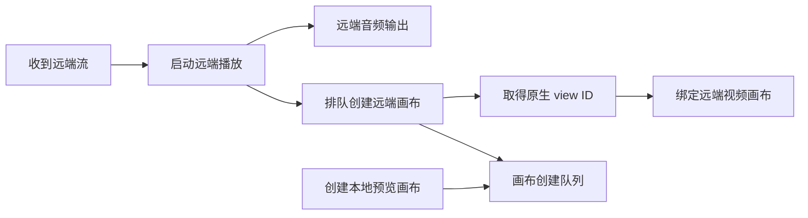

基准：2026-10-10

# iOS 音视频流播放与画布创建

远端流的播放启动和视频画布创建是两件独立的事。播放启动建立音频和视频接收；画布创建只负责把视频绑定到原生视图。

iOS 使用 PlatformView 时，画布创建和绑定按队列串行处理，避免多个原生视图交错创建。远端流到达后，先启动播放，再把画布创建和绑定加入队列。这样本地预览画布即使还没有原生 view ID，也不会挡住远端音频播放。

iOS 原生视频使用 PlatformView 时，Flutter 3.47.x 的非矩形裁剪合成回归可能使圆角视频视图盖住 Flutter overlay 控件。带圆角的视频画面因此使用直角；外层描边和阴影沿用配置颜色并使用直角，底色保持透明。Flutter 官方记录了相关问题：[flutter/flutter#191771](https://github.com/flutter/flutter/issues/191771)、[flutter/flutter#192245](https://github.com/flutter/flutter/issues/192245)。

每条远端流同一时间只保留一个待启动请求。停流或释放流服务会使请求令牌失效；播放启动完成后、画布队列实际执行前都会检查令牌。已失效的请求跳过画布创建并释放队列。远端原生画布回调只有在流 ID、画布代数、用户对象和流记录仍匹配时才释放队列，因此迟到的回调不会覆盖视图状态或越过后续队列任务。本地画布回调按入队时捕获的队列 key 和画布代数校验，房间 ID 变化不会改变旧队列项的身份。清空队列会使旧任务代数失效；旧任务完成后不会推进清空后新建的队列。

